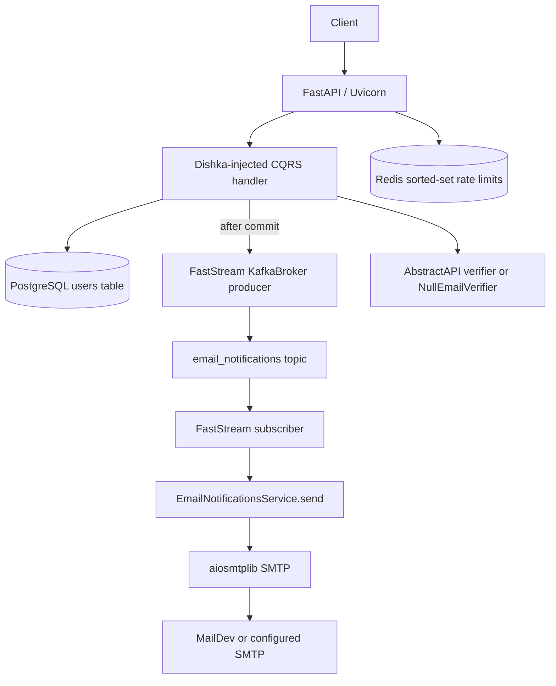

# Notification System — Complete Technical Documentation

> Audit basis: repository contents, static import/wiring analysis, Docker Compose configuration, and test execution on 2026-10-01. “Implemented” means reachable through code, not merely present in a dependency, README, environment variable, or container definition.

## 1. Executive Summary

This is primarily an asynchronous user-account API with email side effects. It provides user registration, JWT login, authenticated read/update/delete operations, Redis sliding-window rate limiting, PostgreSQL persistence, optional external email-address verification, and lifecycle email notifications published to Kafka and consumed by FastStream before SMTP delivery.

It is not a general notification-management system: there is no notification table, notification CRUD API, delivery-status model, template engine, retry policy, dead-letter queue, idempotency key, or delivery audit trail. The repository is best assessed as an educational/prototype service that is development-ready when its dependencies and keys are supplied, but production-incomplete.

Evidence: `src/fastapi_example/__main__.py:11-57`, `presentation/api/v1/controllers/*.py`, `application/features/users/*/handler.py`, `application/services/email_notifications.py`, `presentation/faststream/consumers/email_notifications.py`.

## 2. Problem Being Solved

The implemented problem is managing user accounts while moving account lifecycle emails off the HTTP request path. A user action is persisted synchronously; the email request is then published to Kafka and later sent through SMTP.

## 3. User Journey

1. Client posts username, email, and password.
2. API validates the body, applies IP rate limiting, optionally verifies the email through AbstractAPI, hashes the password, and inserts a user into PostgreSQL.
3. After the database transaction commits, the API publishes an `email_notifications` Kafka message.
4. The FastStream consumer receives the message and sends a plain-text email through `aiosmtplib`—MailDev by default in Compose.
5. Client logs in through OAuth2 form data and receives an RS256 JWT. The token identifies the user for later operations.

There is no client-facing endpoint to submit arbitrary notifications.

## 4. Actual Features

- User registration, lookup of the token subject, update, and deletion: implemented.
- Password hashing with Argon2: implemented.
- JWT access tokens with expiration and RS256 key files: implemented.
- Redis rate limiting: implemented and called by all routes.
- PostgreSQL/SQLAlchemy async persistence and Alembic migrations: implemented.
- Email verification: implemented as either a real AbstractAPI client or an explicit permissive null stub depending on `EMAIL_VERIFIER_ENABLED`.
- Kafka producer and FastStream consumer for lifecycle emails: implemented in application wiring.
- SMTP sending and MailDev development service: implemented/configured.
- Logging to stdout: implemented. Loki/Promtail/Grafana stack: configured, but no application metrics, tracing, dashboards, or alert rules are present.
- Retry, DLQ, idempotency, notification status, delivery tracking: absent.

## 5. Feature Implementation Matrix

| Feature | Claimed in README? | Actually implemented? | Evidence/File | How it works | Tested? | Status |
|---|---|---|---|---|---|---|
| User registration | Yes | Yes | `controllers/users.py:47-73`; `create_user/handler.py:37-66` | Validate, verify email, hash, insert, enqueue account-created email | Yes | Complete for prototype |
| Notification creation API | Implied by project framing | No | No notification route/model/table | Only internal lifecycle messages are created by user handlers | No | Not present |
| User lookup | Yes | Yes | `controllers/users.py:76-105` | JWT subject selects the current user | Yes | Complete for prototype |
| User update/delete | Yes | Yes | `controllers/users.py:108-174` | Authenticated command; delete requires password confirmation | Yes | Complete for prototype |
| Authentication | Yes | Yes | `controllers/auth.py`; `token_jwt.py`; `dependencies/security.py` | OAuth2 password form -> Argon2 check -> RS256 JWT | Yes | Complete for prototype |
| Authorization | Not materially distinguished | Partial | JWT dependency and subject lookup | Any valid user token addresses its own subject; no roles/permissions enforcement | Partial | Partial |
| PostgreSQL | Yes | Yes | `database/connection.py`; `models/user.py`; migrations | Async SQLAlchemy session and explicit transaction manager | Yes, mocked/unit-level | Complete for prototype |
| Redis | Yes | Yes | `rate_limiter.py`; cache provider | Sorted-set timestamps per IP/user/path with expiry | Yes | Complete for rate limiter only |
| Kafka producer | Yes | Yes | `infrastructure/message_broker/producers/email_notifications.py:6-14` | FastStream `KafkaBroker.publish` to `email_notifications` | Indirect/unit coverage; no live broker test verified | Implemented, runtime not live-verified |
| Kafka consumer | Yes | Yes | `presentation/faststream/consumers/email_notifications.py:14-20` | Subscriber maps DTO to email message and calls send | Handler path unit-tested; no live broker test verified | Implemented, runtime not live-verified |
| FastStream | Yes | Yes | `presentation/faststream/setup.py`; `__main__.py:21-24` | One broker, one router, one consumer process task | No live integration test | Implemented |
| Email notification | Yes | Yes | `application/features/users/*/handler.py`; `application/services/email_notifications.py` | Account created/updated/deleted plain text messages | Yes at unit boundaries; SMTP not live-verified | Complete for lifecycle events |
| MailDev | Yes | Yes/configured | `docker-compose.yaml:200-218` | Local SMTP/UI container | No live execution verified | Development integration |
| Email verification | Yes | Yes/optional | `http_clients/email_verifier.py`; provider | Real HTTP client when enabled; permissive stub when disabled | Yes | Partial by configuration |
| Retry | README discusses resilience, but no code | No | No retry/backoff code | Exceptions propagate | No | Not present |
| DLQ | No reliable evidence | No | No topic/handler/config | None | No | Not present |
| Idempotency | No | No | No event ID/status store | Duplicate messages can send duplicate emails | No | Not present |
| Docker | Yes | Yes | `Dockerfile`; Compose | Containers for API/dependencies | Compose syntax validated; stack not started | Development-ready |
| Migrations | Yes | Yes | `infrastructure/database/migrations/` | Two Alembic revisions for `users` | Unit tests only | Implemented |
| Logging | Yes | Yes | `__main__.py:12`; module loggers | Python logs to stdout | Yes in exception tests | Basic |
| Loki/Promtail/Grafana | Yes | Configured | `monitoring/*`; Compose profiles | Promtail discovers Docker logs and pushes to Loki; Grafana provisions Loki datasource | No live verification | Configured but operational status unverified |
| Metrics/tracing/alerts | Implied by “observability” | No | No Prometheus/OpenTelemetry/alert rules | None | No | Not present |
| Tests | Yes | Yes | `test/unit/` | 94 unit/API-style tests | 94 passed with explicit environment/options | Good unit coverage; no live integration |

## 6. Actual Architecture

Data on the HTTP path is JSON except the token endpoint, which uses OAuth2 form fields. User data moves through Pydantic DTOs, dataclass commands, domain entities, and SQLAlchemy repository calls. Kafka messages are the three-field email payload `recipient`, `subject`, `content`; the producer passes the object to FastStream serialization. No Kafka key, custom header, partition, retention, consumer-group, or acknowledgement setting is configured in repository code. Exact runtime defaults are therefore “unable to verify from the available code.”

The critical consistency boundary is `handler transaction -> publish`. The database commits before publish, and there is no outbox. A publish failure therefore returns a server error after the user may already exist.

## 7. Complete Request Flow

### Registration

`POST /api/v1/users` -> `controllers.users.create_user` -> IP Redis limiter -> `CreateUserHandler.execute` -> email verifier -> transaction manager -> repository duplicate check/hash/insert -> commit -> Kafka producer -> HTTP response. The response is returned only after the publish call succeeds. Failure in verification or Kafka prevents a successful response; database failure rolls back the DB transaction.

### Login

`POST /api/v1/token/access` -> OAuth2 form parsing -> IP Redis limiter -> `CreateAccessTokenHandler` -> PostgreSQL user lookup -> Argon2 verification -> RS256 token creation -> JSON token response.

### Get/update/delete

Bearer token extraction -> JWT verification and UUID subject parsing -> IP and per-user Redis limits -> handler -> PostgreSQL transaction. Update and delete publish lifecycle emails after commit. Get has no email side effect. Delete verifies the submitted password even though the request is already authenticated.

## 8. Repository Structure

`domain/` contains the `User` entity and ID/time mixins. `application/features/` contains CQRS-like command/query handlers; `application/interfaces/` contains protocols; `infrastructure/` contains SQLAlchemy, Redis, Kafka, SMTP, hashing, HTTP client, and providers; `presentation/api/` contains FastAPI routes/DTOs; `presentation/faststream/` contains the broker app and consumer; `monitoring/` contains external-stack configuration; `test/unit/` contains tests. There is no `test/integration/` directory despite `pytest.ini` listing it.

### Dead, unused, or scaffolded areas

- The `test/integration` path is configured in pytest but absent.
- Grafana’s TestData datasource is provisioned but is not an application data source.
- Monitoring files configure collection, but the application has no metrics/traces and no dashboards or alert rules.
- The application contains interfaces for notification/email abstractions, but no persisted notification aggregate or status implementation.
- Kafka has only the one lifecycle-email topic; no retry/DLQ topic or administrative topic is defined.
- `EMAIL_VERIFIER_ENABLED=False` in the example configuration selects `NullEmailVerifier`, so the real AbstractAPI integration is configured as optional rather than guaranteed in a normal local run.
- Docker Compose includes port-forwarder services and monitoring profiles that are useful scaffolding, but they do not prove that those stacks are used in an active deployment.
- No unused dependency can be declared solely from `pyproject.toml`; dependency presence is not proof of runtime use. The application’s direct imports do confirm `httpx`, `aiosmtplib`, Redis, FastStream, SQLAlchemy, and security libraries are used.

## 9. FastAPI

`init_app_v1` creates the app from settings, attaches Dishka, registers routers, exception handlers, and CORS. Routes are async and use `DishkaRoute`/`FromDishka`. Pydantic DTOs validate request and response shapes. OAuth2 bearer extraction is present, but the security dependency only extracts a token; JWT verification is performed explicitly in controllers through the injected JWT service. No startup/shutdown handlers are registered in FastAPI; the process lifecycle is coordinated in `__main__.py` and Dishka providers.

Removing Dishka breaks handler/service resolution. Removing the exception setup changes custom errors to generic framework behavior. Removing the Redis checks removes rate limiting. Removing the FastStream task leaves the producer/consumer broker lifecycle unrun.

## 10. API Endpoints

| Method/path | Auth | Body | Success | Side effects |
|---|---|---|---|---|
| POST `/api/v1/users` | No | `{username,email,password}` | 201 `UserResponseDTO` with id, username, email, timestamps | DB insert; account-created Kafka email |
| GET `/api/v1/users` | Bearer | None | 200 current `UserResponseDTO` | DB read |
| PATCH `/api/v1/users` | Bearer | `{username?: string, email?: string}`; at least one required | 200 updated user | DB update; account-updated Kafka email |
| DELETE `/api/v1/users` | Bearer | `{password}` | 200 deleted user representation | DB delete; account-deleted Kafka email |
| POST `/api/v1/token/access` | No | OAuth2 form `username`, `password`, optional `scope` | 201 `{access_token, token_type:"Bearer"}` | DB read; token creation |

Relevant current errors: body validation is converted by the custom handler to HTTP 400 (not FastAPI’s normal 422); custom bad input is 400; invalid/missing JWT is 401; wrong delete password is 403; duplicate user is 409; missing user is 404; Redis limit is 429; email verifier unavailable is 503; uncaught errors become 500. A Kafka/SMTP/DB exception is generally an uncaught 500 unless translated elsewhere. There is no route-level 409 for database race-condition uniqueness errors verified in code.

## 11. PostgreSQL

The configured driver is `postgresql+asyncpg`; SQLAlchemy creates an async engine with default options (`create_async_engine(url)`), and `async_sessionmaker` uses `autoflush=False`, `expire_on_commit=False`. A request-scoped session is supplied by Dishka. There is no explicit pool-size/timeout configuration, so SQLAlchemy defaults apply.

## 12. Database Schema

The only table is `users`: UUID primary key with server default `gen_random_uuid()`, `username` string length 50, unique/non-null; `email` string length 250, unique/non-null and indexed; `password` non-null text; `created_at` and `updated_at` timezone-aware timestamps with `now()` defaults. There are no foreign keys or relationships. The ORM model is `UserModel`; the repository maps it to the domain `User`. User handlers write it; get/login/read paths read it.

The first migration creates the table and ID index; the second changes password to text, adds the unique email index, and adds username uniqueness. The migration itself does not show an explicit `pgcrypto` extension creation; whether `gen_random_uuid()` is available depends on the PostgreSQL image/environment.

## 13. Redis

Redis is not a general cache here. It stores sliding-window rate-limit timestamps in sorted sets. Keys are `rl:{identifier}:{path}`, members are `{timestamp}:{uuid}`, scores are Unix timestamps, and TTL is the configured window. A pipeline removes old members, adds the current request, counts, and expires the key. It is read/written by every route through `RateLimiterService`; cache misses mean a new sorted set is created. Redis unavailability is not caught by the route layer and will normally surface as HTTP 500. No business data is cached.

## 14. Kafka

The broker is created as `KafkaBroker(settings.url)`, with URL derived from `MESSAGE_BROKER_HOST`/`PORT`. The only topic in application code is `email_notifications`. The producer publishes a typed three-field payload. No explicit key, headers, partition, retention, replication, security, producer retry, consumer group, or offset policy is present in repository code. Kafka Compose is a single-node KRaft broker with replication factors of 1 for internal topics; topic-specific partition/retention settings are not configured.

## 15. Kafka Producer

`EmailNotificationsProducer.publish` awaits `broker.publish(message, topic="email_notifications")`. It is called by `EmailNotificationsService.enqueue`, which is called after user create/update/delete transactions. Serialization and acknowledgement details are delegated to FastStream/aiokafka defaults and are not explicitly configured here. Exceptions propagate to the HTTP handler. There is no durable publish-after-commit mechanism.

## 16. Kafka Consumer

`KafkaRouter.subscriber("email_notifications")` registers `email_notifications`. FastStream converts the payload into `EmailNotificationDTO`, the handler builds the application message, and calls `service.send`. If the handler raises, there is no application retry or DLQ logic. Exact broker offset timing is delegated to FastStream defaults and is not verified from repository code.

## 17. FastStream

`init_faststream` obtains the shared `KafkaBroker`, includes the router, creates `FastStream(broker)`, and attaches Dishka auto-injection. `__main__.py` runs the FastStream app and Uvicorn concurrently. FastStream gives the project typed subscriber registration and framework-managed Kafka integration; the repository does not demonstrate custom behavior beyond that abstraction.

## 18. Async Processing

Async code covers FastAPI handlers, SQLAlchemy/asyncpg, Redis, HTTPX email verification, Kafka publish/consume, SMTP, and service orchestration. Argon2 hashing and password verification are synchronous CPU work inside async handlers; that is a potential event-loop blocking point under load. Logging and Pydantic work are also synchronous but small. The external verifier has a 5-second HTTP timeout; SMTP has no explicit timeout in this code. Kafka and SMTP operations are off the request path only for sending; Kafka publication itself remains on the request path.

## 19. Email Notification System

Messages are plain text, built with `email.message.EmailMessage`, and sent by `EmailSender` via an app-scoped `aiosmtplib.SMTP` client. There are no HTML templates, attachments, delivery status records, retries, timeout policy, bounce handling, or provider failover. Successful send returns SMTP response data but the consumer discards it. Invalid recipient/provider failures raise through the consumer. Duplicate consumption can send duplicate emails.

## 20. MailDev

Compose runs `maildev/maildev` on SMTP 1025 and web 1080. The API container joins the SMTP network but the API service does not explicitly depend on MailDev. MailDev is a local development sink, not a production provider. The web UI is exposed only through the port-forwarder profile on loopback.

## 21. Docker

The Dockerfile uses `python:3.13-slim-bookworm`, installs `gcc`, `git`, and `uv`, creates a Python 3.13 environment, installs locked dependencies, copies source, and runs `uv run api`. It is suitable for development and a small prototype. It is not hardened: base image tags are not pinned to digests, the container runs as the default root user, build/runtime layers are not separated, and no explicit healthcheck is defined.

## 22. Docker Compose

Services are PostgreSQL, Redis, Kafka, API, migrations, Grafana, Loki, Promtail, MailDev, and several loopback socat port forwarders. PostgreSQL/Redis/Kafka have healthchecks; API depends on PostgreSQL and Kafka but not Redis or MailDev. The API mounts source and JWT certs and exposes 8080. Monitoring uses separate networks; Promtail reads the host Docker socket/log directory and pushes to Loki. Compose uses `latest` for PostgreSQL, Redis, Grafana, and Loki, which harms reproducibility. Kafka and Postgres are single-node/single-replica development configurations.

## 23. Clean Architecture

The dependency direction is substantially intentional: controllers depend on application commands/interfaces, handlers depend on interfaces, and infrastructure implements those interfaces. Domain entities are small and framework-free. This supports an Onion/Clean Architecture claim at the structural level.

It is not a pure implementation: application settings import infrastructure settings; application JWT service imports `JWTSettings` from infrastructure; application services are coupled to `aiosmtplib` response types; application handlers mutate command objects to hash the password; the composition root imports every concrete provider. The README’s “vertical slices” are mainly application feature folders, while infrastructure remains shared. Truthful wording is “layered/Onion-inspired architecture with dependency inversion,” not “strict Clean Architecture.”

## 24. Logging

`logging.basicConfig` sends INFO logs to stdout. Modules log successful operations and failures. Some logs include email addresses, usernames, and message contents (`EmailNotificationsService` logs the full message), which is sensitive-data exposure in production. There is no structured logging, correlation ID, request ID, redaction policy, or log level configuration beyond basic setup.

## 25. Loki

Loki is configured with filesystem storage, replication factor 1, auth disabled, and a local in-memory ring. Promtail discovers Docker containers through the Docker socket and pushes to Loki. The path is configured, but no execution of the monitoring profile was verified. This is configured log aggregation, not proven production observability.

## 26. Grafana

Grafana provisions a Loki datasource and a testdata datasource. No dashboard JSON, alert rule, or application metric datasource is present. Anonymous admin access is enabled in Compose. Classification: configured, partially wired, and unsuitable as production security/monitoring without hardening.

## 27. Testing

Tests are predominantly unit tests with mocks/fakes, plus controller and DTO tests. They cover handlers for auth/user operations, rate limiter/token services, domain user, providers, email verifier, exception handlers, and API controller behavior. Command used successfully: `$env:PYTHONPATH='src'; python -m pytest -q -o addopts='' -p no:cov`; result: **94 passed, 1 deprecation warning, 28.91 seconds**. Default `python -m pytest -q` failed before collection because pytest-cov attempted to erase a locked `.coverage` file. No live PostgreSQL, Redis, Kafka, SMTP, Compose, or end-to-end MailDev test was verified. Coverage percentage was not reported because the successful command disabled the repository coverage plugin.

## 28. Error Handling

Custom application exceptions map to 400/401/403/404/409/429/503/501/500. Validation is deliberately mapped to 400. Unknown exceptions are logged with a traceback and returned as `{"status":500,"message":"Unknown Error"}`. Database transaction context rolls back on handler exceptions and wraps commit/rollback SQLAlchemy errors. Kafka publication, Redis access, SMTP sending, and most external failures have no retry or circuit breaker. Email verification translates timeouts/network/5xx into 503, but the actual email delivery path does not.

## 29. Security

Implemented: Argon2 password hashing; JWT RS256 private/public keys; bearer extraction; input DTO validation; parameterized SQLAlchemy statements; environment-based settings; password confirmation for deletion. Missing/weak: default wildcard CORS with credentials, anonymous Grafana admin, plaintext Kafka/Redis/SMTP in Compose, no rate-limit response headers, no roles/permissions, no refresh/revocation strategy, no secret manager, possible sensitive logs, root container, unpinned images, and no verified TLS configuration. `.env` exists locally and should not be treated as safe to commit; key files under `.certs` require secret-management review.

## 30. Current Limitations

The database and Kafka publish are dual writes without an outbox; lifecycle emails can be lost or duplicated. There is no notification state, retries, DLQ, idempotency, delivery receipt, or provider abstraction beyond SMTP. Async CPU hashing can block the event loop. Operational defaults are development-only. Authorization is identity-based only. Monitoring has logs but no metrics, traces, dashboards, or alerts.

## 31. Production Gap Analysis

| Area | Current Project | Production Requirement | Gap | Improvement | Why it matters |
|---|---|---|---|---|---|
| Kafka failure | Publish exception reaches API | Durable acceptance or explicit failure contract | DB may already commit | Transactional outbox + publisher retry | Prevents lost lifecycle events |
| Email failure | Consumer exception; no policy | Bounded retries and terminal state | Temporary failures lose/loop unpredictably | Retry with exponential backoff and DLQ | Recovers transient outages |
| Duplicates | No event identity | At-least-once-safe handler | Duplicate emails possible | Event ID + delivery/idempotency store | Prevents repeated side effects |
| Retry/DLQ | Absent | Observable bounded redelivery | Poison messages have no controlled path | Retry topics and DLQ with alerting | Protects consumer health |
| DB consistency | Commit then publish | Atomic intent | Dual-write window | Outbox in same DB transaction | Preserves event intent |
| Auth/authorization | JWT subject only | Roles/scopes/revocation policy | No access policy beyond self | Enforce scopes/roles and key rotation | Limits unauthorized actions |
| Rate limiting | Redis sorted-set, defaults | Shared limits with fail policy | Redis outage is 500; no headers | Decide fail-open/closed, headers, atomic script | Predictable abuse control |
| Secrets | `.env`, mounted keys | Secret manager/rotation | Credentials and keys operationally exposed | Vault/cloud secrets and rotation | Reduces compromise blast radius |
| Logging | Plain text, message contents | Structured/redacted logs | Sensitive data and no correlation | JSON logs, request/event IDs, redaction | Debuggability and privacy |
| Metrics | None | RED/business metrics | No queue lag/send success visibility | Prometheus/OpenTelemetry metrics | Capacity and SLO decisions |
| Tracing | None | Cross-service traces | Cannot follow request->event->email | Trace/context propagation | Faster incident diagnosis |
| Scaling | Single Kafka/Postgres dev config | Partitioned broker and pooled consumers | Throughput ceiling unclear | Size partitions, consumer groups, DB pool | Handles 10k/minute safely |
| Indexes | PK, unique username/email index | Query-driven indexes | No notification/status queries exist | Add only with new access patterns | Avoids unnecessary indexes |
| Deployment | Root, latest tags, source mount | Immutable hardened images | Non-reproducible/insecure runtime | Pin images, non-root, CI migrations | Safe repeatable releases |
| Monitoring/alerts | Loki datasource only | Dashboards and alerts | No alerting | Add Kafka lag, error, SMTP, DB, Redis alerts | Detects failure before users report it |

## 32. Scalability

At 10 notifications/minute the current design is adequate for development. At 10,000/minute, the bottleneck is likely SMTP/provider throughput and the single Kafka broker/partition configuration, followed by consumer concurrency and the shared SMTP client. API instances can scale horizontally, but each needs DB/Redis connections and Kafka producer connections. PostgreSQL user writes are modest, but connection-pool defaults and synchronous Argon2 work require measurement. Production changes should include explicit pool sizing, Kafka partitions and consumer-group instances, provider quotas/batching where supported, bounded retries/backpressure, queue-lag metrics, and a durable delivery state. Kubernetes alone does not solve provider limits or dual-write loss.

## 33. Reliability

The current system has rollback for a failing DB transaction, but not for external side effects. Redis failure rejects requests. Kafka failure after DB commit leaves a user without its lifecycle email. Consumer crash behavior depends on FastStream/Kafka defaults; the handler has no application-level status. SMTP failure raises and may cause broker redelivery, but exact offset behavior is not verified. Duplicate Kafka messages send duplicate emails. A DB write succeeds and Kafka publication fails because they are separate operations; Kafka publication succeeds and the consumer crashes before send or acknowledgement according to broker/framework defaults. Sending succeeds and a crash before acknowledgment can resend.

## 34. Failure Scenarios

| Scenario | Current behavior | Risk | Production solution |
|---|---|---|---|
| PostgreSQL down | DB exception, normally 500 | Request unavailable | Health/readiness, bounded connection retries, clear 503 |
| Redis down | Limiter exception, normally 500 | All routes depend on Redis | Explicit fail-open/closed policy and alert |
| Kafka down | Publish exception after DB commit | Lost event and 5xx | Outbox + publisher retry |
| Consumer crashes | Broker/framework may redeliver; not app-controlled | Duplicate/lost delivery uncertainty | Retry policy, visibility, idempotent handler |
| Email provider down | SMTP exception from consumer | Repeated failure/poison message | Backoff, DLQ, provider timeout/failover |
| Duplicate message | Email sent again | Duplicate notification | Event ID/idempotency key |
| DB succeeds/Kafka fails | User remains, response fails | Client may retry and see conflict | Outbox and idempotent API semantics |
| Kafka succeeds/consumer crashes | Message remains or redelivers per defaults | Duplicate possible | Explicit ack/retry and idempotent send |
| Send succeeds/crash before record | No success record exists | Duplicate on redelivery | Provider/message idempotency or delivery ledger |

## 35. Data Consistency

The system is at-least-once in practical risk profile, not exactly-once. PostgreSQL commits user state, then Kafka publishes; email is a third system. There is no distributed transaction. The outbox pattern is directly justified because the repository has an identifiable database-commit/Kafka-publish gap. An event ID and delivery ledger are directly justified because a successful SMTP send can be followed by consumer failure. “Exactly once” should not be claimed; the realistic target is at-least-once processing with idempotent side effects.

## 36. Production Improvements

First add an outbox row in the same DB transaction as the user change, then publish/retry from a separate worker. Add event IDs, delivery attempts, status, timestamps, and a DLQ. Add explicit timeouts and exponential backoff around SMTP, provider health metrics, structured logs, correlation IDs, and Kafka lag/send-failure dashboards. Then harden deployment (non-root, pinned images, secrets, TLS, restricted CORS/Grafana), add live integration tests, and measure Argon2/DB/Kafka/SMTP capacity before selecting concurrency.

## 37. What I Personally Implemented

The repository itself cannot establish authorship. Git history/metadata should be reviewed before claiming personal ownership. Based only on code, a contributor can truthfully say they worked on the user/auth API, async persistence, Redis rate limiting, Kafka/FastStream email flow, and tests only if they personally wrote or changed those files. The safest wording is “I worked on/understand this implementation,” not “I designed and implemented the entire production system,” unless commit history confirms it.

## 38. What I Should NOT Claim

Do not claim a general notification platform, delivery tracking, retries, DLQ, idempotency, exactly-once processing, production-ready observability, live integration coverage, role-based authorization, or strict Clean Architecture. Do not claim Kafka partitions/consumer groups/retention settings that are not explicit here. Do not claim MailDev production email delivery.

## 39. Interview Project Explanation

1. **Problem:** account lifecycle actions need email side effects without making SMTP part of the request latency.
2. **Users:** clients registering and managing accounts; operators inspecting local emails/logs.
3. **Pain point:** synchronous email delivery is slow and failure-prone.
4. **Solution:** commit user changes in PostgreSQL, publish lifecycle email commands to Kafka, consume with FastStream, and send over async SMTP.
5. **Decisions:** FastAPI/async libraries for I/O; PostgreSQL for relational user data; Redis for distributed rate-limit state; Kafka for buffering/decoupling; FastStream for typed broker integration; MailDev for local SMTP inspection.
6. **Implementation:** route -> DTO/dependency -> handler -> repository/transaction -> producer -> topic -> consumer -> SMTP.
7. **Real challenges:** dual-write consistency, duplicate delivery, external-service failures, and synchronous password hashing inside async handlers.
8. **Current handling:** rollback DB transactions, custom HTTP errors, optional verifier stub, basic logging, and framework-managed broker operations.
9. **Limitations:** no durable delivery ledger, retry/DLQ, idempotency, metrics, tracing, or production hardening.
10. **Production changes:** outbox, idempotent delivery, retry/DLQ, observability, secrets/TLS, hardened containers, and integration tests.

## 40. “Why?” Questions

| Question | Short answer grounded in code | Production consideration |
|---|---|---|
| Why FastAPI? | Async routes, Pydantic DTOs, OAuth2 helpers, OpenAPI setup | Add versioned contracts and consistent error schema |
| Why not Flask? | Flask could work, but this code uses async stack end-to-end | Async only helps if dependencies remain non-blocking |
| Why PostgreSQL? | Users have structured fields, uniqueness, transactions | Add pool sizing, backups, migrations discipline |
| Why not MongoDB? | No document-oriented access pattern exists | Choose based on access patterns, not trend |
| Why Redis? | Shared sliding-window limiter state across API instances | Define outage policy and secure/TLS deployment |
| Why not PostgreSQL for limits? | Redis gives fast expiring sorted-set operations | Redis is not a durable audit store here |
| Why Kafka? | Decouples lifecycle email send from request path | Requires outbox, partitions, lag monitoring, retries |
| Why not Redis Pub/Sub? | Kafka gives durable broker semantics in principle | Current code does not configure durability policy explicitly |
| Why FastStream? | Typed router/subscriber and Dishka integration reduce broker boilerplate | Know the underlying offset/error semantics before production |
| Why async? | DB, Redis, HTTPX, Kafka, SMTP are I/O-bound | Move/limit Argon2 CPU work to avoid event-loop stalls |
| Why Docker Compose? | Reproduces local dependency stack | Pin images and separate dev/prod topology |
| Why MailDev? | Local SMTP sink and UI | Never use it as production delivery provider |
| Why repository pattern? | Handlers depend on `IUsersRepository`, not SQLAlchemy | Keep interfaces stable and test adapters realistically |
| Why this topic/message? | One `email_notifications` topic and three fields match the consumer DTO | Add version/event ID/status for evolution |
| Why current error handling? | Custom exceptions centralize HTTP mapping | Add domain-specific external error policy and correlation IDs |

## 41. “How?” Questions

- **How is a user created?** `create_user` builds `CreateUserCommand`; handler verifies email, checks duplicates, hashes, inserts inside `TransactionManager`, then enqueues a Kafka email.
- **How is authentication performed?** OAuth2 form is parsed; repository loads username; Argon2 verifies password; JWT service signs an RS256 token with `iat`/`exp`.
- **How is authorization performed?** Bearer token is verified and its UUID subject is used as the target user. No role policy exists.
- **How does rate limiting work?** Redis pipeline maintains timestamp members in a sorted set, then count is compared with route-specific limits.
- **How is email asynchronous?** Only publish is awaited by the API; SMTP runs in the FastStream consumer task.
- **How are transactions handled?** `async with TransactionManager` begins, commits on success, rolls back on exception.

## 42. “What If?” Questions

For Kafka/Redis/PostgreSQL/email-provider outages, duplicate messages, simultaneous load, duplicate submissions, unknown users, 30-second email latency, API restart, and Kafka restart: current behavior is respectively publish/Redis/DB/SMTP exceptions, duplicate sends on redelivery, shared dependency saturation, database uniqueness conflict, 404, consumer latency/backlog, process shutdown, and framework-dependent reconnect/redelivery. The production answers are explicit timeouts and status codes, outbox, retry/DLQ, idempotency, uniqueness plus idempotency keys, autoscaled consumers/partitions, and integration tests that verify broker restart behavior.

## 43. Code-Level Interview Questions

1. Open `presentation/api/v1/controllers/users.py`: why does update have no path ID?
2. Open `application/features/users/create_user/handler.py`: what happens between commit and Kafka publish?
3. Open `infrastructure/database/transaction_manager.py`: why reject nested transactions?
4. Open `infrastructure/message_broker/producers/email_notifications.py`: what serialization/ack behavior is explicit?
5. Open `presentation/faststream/consumers/email_notifications.py`: where is duplicate prevention?
6. Open `infrastructure/cache/repositories/rate_limiter.py`: is the pipeline atomic enough for the desired limit semantics?
7. Open `application/services/token_jwt.py`: how are keys, expiration, and invalid tokens handled?
8. Open `infrastructure/http_clients/email_verifier.py`: why is the null verifier permissive?
9. Open `presentation/api/common/handlers/exception_handlers.py`: why are validation errors 400 rather than 422?
10. Open `docker-compose.yaml`: why are images/latest, single-node Kafka, and anonymous Grafana unsafe for production?

## 44. Difficult Follow-Up Questions

- How would you prove an email was not sent twice after a crash?
- What exact guarantee does the current producer provide when PostgreSQL has committed?
- What happens if a client retries a 500 after a successful DB commit?
- How would you preserve the outbox event if Kafka is unavailable for an hour?
- How would you distinguish a poison message from a temporary SMTP outage?
- What metrics define a healthy notification pipeline?
- How would you scale Argon2 verification without blocking the event loop?
- Why is an outbox preferable to claiming a distributed transaction here?

## 45. 30-Minute Interview Revision Sheet

Remember: this is a user API with lifecycle email events, not a full notification platform. Know the route paths, the single `users` table, Redis key format, topic `email_notifications`, three-field message, handler/consumer files, Argon2 + RS256, and the commit-then-publish consistency gap. Be ready to say 94 tests passed under the explicit command, but no live dependency integration was verified. Lead with the outbox/idempotency/retry/DLQ production plan.

## 46. 5-Minute Last-Minute Revision Sheet

**Flow:** FastAPI -> handler -> PostgreSQL -> Kafka -> FastStream -> SMTP/MailDev.

**Implemented:** user CRUD/auth, async DB, Redis rate limiting, lifecycle emails, Docker, basic tests/logging.

**Not implemented:** notification API/status, retries, DLQ, idempotency, metrics/tracing/alerts, role authorization.

**Biggest risk:** DB commits before Kafka publish; email can be lost or duplicated.

**Best production answer:** transactional outbox + event ID/idempotent consumer + bounded retries/DLQ + metrics/alerts.

## Verified by Execution

| Command | Result | Interpretation |
|---|---|---|
| `python -m pytest -q` | Failed before collection: locked `.coverage` access denied | Repository default invocation is environment-sensitive here |
| `$env:PYTHONPATH='src'; python -m pytest -q -o addopts='' -p no:cov` | 94 passed, 1 warning | Unit/API tests execute successfully; coverage omitted |
| `docker compose config --quiet` | Completed with Docker config permission warnings | Compose syntax was accepted; services were not started |
| Live API/Compose/Kafka/MailDev/Grafana verification | Not run | Dependencies/runtime execution were not established |

## PROJECT TRUTH SHEET

- **Project:** FastAPI user/account service with asynchronous lifecycle email delivery.
- **Primary purpose:** Persist/manage users and decouple account emails from SMTP request latency.
- **Main users:** API clients and local developers/operators.
- **Main workflow:** user command -> PostgreSQL -> Kafka email event -> FastStream -> SMTP/MailDev.
- **Actually implemented:** user CRUD/auth; Argon2 + RS256; async PostgreSQL; Redis rate limiting; Kafka/FastStream lifecycle emails; optional email verification; Docker/Compose; 94 passing tests under explicit command.
- **Partially implemented:** authorization; email verification as a real provider; observability; production deployment hardening.
- **Configured but unused/limited:** Grafana testdata datasource; no application metrics/tracing; monitoring stack not live-verified; SMTP/MailDev is development-oriented; no Redis business cache beyond rate limiting.
- **Mentioned but not verified:** “production-ready,” comprehensive observability, full automation, live Kafka/SMTP behavior, and any README claim not backed by a live integration test.
- **Not implemented:** notification submission/status API; retry/DLQ; idempotency; delivery ledger; exactly-once; roles; metrics/tracing/alerts.
- **My actual contribution:** cannot be established from the working tree alone; use Git history to identify personal changes.
- **Most important technologies:** FastAPI/asyncio; PostgreSQL + SQLAlchemy/asyncpg; Kafka + FastStream; Redis; SMTP/MailDev.
- **Biggest architectural decisions:** interface-based layered composition; explicit transaction manager; asynchronous broker-mediated email; Redis sliding-window limiting.
- **Current limitations:** dual writes; duplicate/lost email risk; weak production security/observability; no live integration coverage.
- **Most important production improvements:** outbox; event IDs/idempotent delivery with retries/DLQ; metrics/tracing/alerts and hardened deployment.
- **Most likely interview questions:** DB/Kafka consistency; duplicate email prevention; consumer crash behavior; Redis limiter semantics; scaling Kafka/SMTP.
