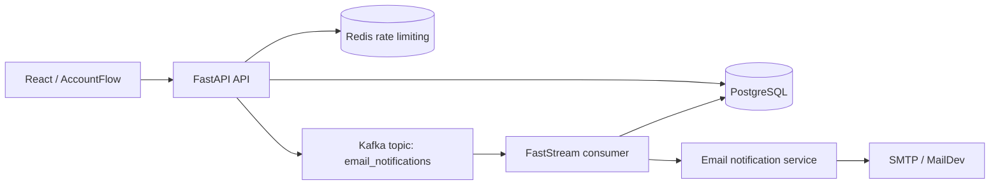
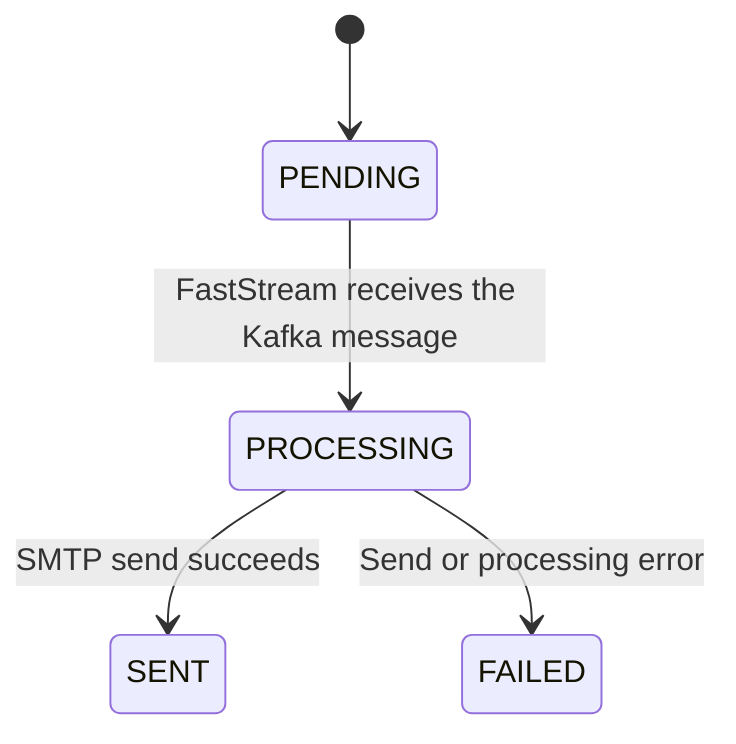

# FastAPI Notification Backend

FastAPI-based account service with JWT authentication, PostgreSQL persistence, Redis-backed rate limiting, and asynchronous lifecycle email notifications. Every account lifecycle email is persisted as a notification event so the client can show real processing history rather than inferred activity.

**Frontend:** [fastapi-notification-frontend](https://github.com/DhrithiHH/fastapi-notification-frontend)

**Backend repository:** [fastapi-notification-backend](https://github.com/DhrithiHH/fastapi-notification-backend)

## What it does

The service supports a focused account journey:

1. Register an account.
2. Obtain a JWT access token with username and password.
3. Read or update the authenticated account.
4. Delete the account after password confirmation.
5. View persisted lifecycle notification events for the authenticated account.

Registration, profile changes, and account deletion each create an event and enqueue an email asynchronously. The HTTP request does not wait for SMTP delivery.

## Architecture



- **PostgreSQL** stores users and `notification_events`.
- **Redis** stores sliding-window rate-limit state.
- **Kafka** decouples lifecycle email publishing from HTTP handling.
- **FastStream** consumes the `email_notifications` topic and updates the matching notification event as processing progresses.
- **MailDev** is the local SMTP sink and web viewer used by the Docker development stack.

The application is organized around domain, application, infrastructure, and presentation layers, with feature handlers and Dishka dependency injection.

## Technology stack

| Area | Implemented technology |
| --- | --- |
| API | FastAPI `>=0.119.1,<0.120.0`, Uvicorn `>=0.38.0,<0.39.0` |
| Validation/settings | Pydantic Settings `>=2.11.0,<3.0.0` |
| Database | PostgreSQL, SQLAlchemy `>=2.0.44,<3.0.0`, asyncpg `>=0.30.0,<0.31.0`, Alembic `>=1.17.0,<2.0.0` |
| Authentication | PyJWT `>=2.10.1,<3.0.0`, RS256 keys, pwdlib with Argon2 `>=0.3.0,<0.4.0` |
| Messaging/email | FastStream Kafka `>=0.6.7`, Kafka, aiosmtplib `>=5.1.0`, MailDev |
| Rate limiting | Redis `>=7.3.0` |
| DI and tooling | Dishka `>=1.7.2,<2.0.0`, uv, pytest, Ruff, MyPy |
| Optional local monitoring profile | Grafana, Loki, Promtail |

## Features

- User registration, current-user lookup, profile update, and password-confirmed deletion.
- JWT-protected account and notification endpoints.
- Argon2 password hashing through `pwdlib[argon2]`.
- Redis-backed per-IP and per-user rate limits on API routes.
- Asynchronous `ACCOUNT_CREATED`, `ACCOUNT_UPDATED`, and `ACCOUNT_DELETED` emails.
- Persistent, user-scoped notification history sorted newest first.
- Kafka messages carry the same UUID as the persisted notification event.
- SMTP health checking with `NOOP` and reconnection for stale transports after an SMTP server restart.

## Notification lifecycle

### Event types

| Event type | Created when |
| --- | --- |
| `ACCOUNT_CREATED` | An account is successfully registered |
| `ACCOUNT_UPDATED` | The authenticated account is successfully updated |
| `ACCOUNT_DELETED` | Password-confirmed account deletion succeeds |

### Statuses



`notification_events` contains a UUID `id`, nullable `user_id`, `event_type`, `recipient`, `status`, `created_at`, and nullable `processed_at`.

- `created_at` records event creation.
- `processed_at` is set when processing completes as `SENT` or `FAILED`.
- The event ID is the Kafka `event_id`, so the consumer updates the same database record.
- The foreign key uses `ON DELETE SET NULL`. A deletion event is created before the user is removed, and notification rows survive account deletion with `user_id` set to `NULL`.
- `SENT` means the current SMTP operation succeeded. It does **not** prove inbox delivery, opening, or recipient engagement.

### SMTP reconnection behavior

The SMTP client is application-scoped and reused. Before a send, the sender verifies an existing connection with SMTP `NOOP`. A disconnected or stale transport is closed and reconnected using the configured SMTP settings. A send-time transport error closes the client for a later event, but the same message is not retried because it may already have reached the SMTP server. The consumer records that event as `FAILED`.

## API

The configured defaults expose Swagger UI at `http://localhost:8080/docs` and ReDoc at `http://localhost:8080/redoc`. The application URL and documentation paths are configurable through `APP_*` settings.

Protected endpoints require:

```http
Authorization: Bearer <access_token>
```

| Method | Path | Auth | Request body | Success response |
| --- | --- | --- | --- | --- |
| `POST` | `/api/v1/users` | No | JSON: `username`, `email`, `password` | `201` user object |
| `POST` | `/api/v1/token/access` | No | `application/x-www-form-urlencoded`: `username`, `password` | `201` token object |
| `GET` | `/api/v1/users` | Bearer | — | `200` current user |
| `PATCH` | `/api/v1/users` | Bearer | JSON with at least one of `username`, `email` | `200` updated user |
| `DELETE` | `/api/v1/users` | Bearer | JSON: `password` | `200` deleted user |
| `GET` | `/api/v1/notifications` | Bearer | — | `200` current user's events |

### Response shapes

User responses use:

```json
{
  "id": "uuid",
  "username": "account_name",
  "email": "user@example.com",
  "created_at": "2026-10-08T18:27:01Z",
  "updated_at": "2026-10-08T18:27:01Z"
}
```

The token endpoint returns:

```json
{
  "access_token": "<JWT>",
  "token_type": "Bearer"
}
```

`GET /api/v1/notifications` returns a plain JSON array, scoped from the JWT subject rather than a client-supplied user ID:

```json
[
  {
    "id": "uuid",
    "event_type": "ACCOUNT_UPDATED",
    "recipient": "user@example.com",
    "status": "SENT",
    "created_at": "2026-10-08T18:27:01Z",
    "processed_at": "2026-10-08T18:27:02Z"
  }
]
```

Route-specific errors include authentication, validation, conflict, not-found, forbidden, rate-limit, and service-unavailable responses where applicable. Consult `/docs` for the generated contract.

## Local setup

### Prerequisites

- Docker Desktop with Docker Compose.
- Python 3.12+ and [uv](https://docs.astral.sh/uv/) only if running the backend outside Docker.
- OpenSSL available on your path if local JWT development keys are absent.

### 1. Configure local environment values

In PowerShell, from this repository:

```powershell
Copy-Item .env_example .env
```

Set your own development values in `.env`; do not commit secrets. The settings file recognizes these groups:

| Group | Variables |
| --- | --- |
| PostgreSQL | `DB_HOST`, `DB_PORT`, `DB_USERNAME`, `DB_PASSWORD`, `DB_DATABASE` |
| Redis | `REDIS_HOST`, `REDIS_PORT`, `REDIS_PASSWORD` |
| Kafka | `MESSAGE_BROKER_HOST`, `MESSAGE_BROKER_PORT` |
| SMTP | `SMTP_HOST`, `SMTP_PORT`, `SMTP_USE_TLS`, `SMTP_SENDER`, optional `SMTP_USERNAME`, `SMTP_PASSWORD` |
| API/server | `APP_TITLE`, `APP_VERSION`, `APP_DOCS_URL`, `APP_REDOC_URL`, `UVICORN_SERVER_HOST`, `UVICORN_SERVER_PORT` |
| CORS | `CORS_ORIGINS`, `CORS_METHODS`, `CORS_HEADERS` |
| Optional email validation | `EMAIL_VERIFIER_API_KEY`, `EMAIL_VERIFIER_ENABLED` |
| JWT | `JWT_ALGORITHM`, `JWT_EXPIRATION` |

For the API container, use Docker service names: `DB_HOST=postgres`, `REDIS_HOST=redis`, `MESSAGE_BROKER_HOST=kafka` with `MESSAGE_BROKER_PORT=29092`, and `SMTP_HOST=maildev`. The sample `.env_example` uses localhost values for host-run processes.

The JWT service loads RS256 key files from `.certs/jwt-private.pem` and `.certs/jwt-public.pem`. If they are missing, create development-only keys, for example:

```powershell
New-Item -ItemType Directory -Force .certs
openssl genrsa -out .certs/jwt-private.pem 2048
openssl rsa -in .certs/jwt-private.pem -pubout -out .certs/jwt-public.pem
```

Keep private keys out of source control and use appropriately managed keys outside local development.

### 2. Start the Docker stack and apply migrations

```powershell
docker compose --profile api up --build -d
docker compose --profile migrations run --rm migrations
docker compose ps
```

The `api` profile starts PostgreSQL, Redis, Kafka, MailDev, and the FastAPI application. The migrations profile runs `alembic upgrade head`.

The API is published on `http://localhost:8080`. To follow logs:

```powershell
docker compose logs -f api
```

### Ports

| Service | Inside Docker network | Optional host forwarding |
| --- | --- | --- |
| FastAPI | `api:8080` | `http://localhost:8080` |
| PostgreSQL | `postgres:5432` | `127.0.0.1:5432` with `port-forwarder` profile |
| Redis | `redis:6379` | `127.0.0.1:6379` with `port-forwarder` profile |
| Kafka | `kafka:29092` | `127.0.0.1:9092` with `port-forwarder` profile |
| MailDev SMTP | `maildev:1025` | `127.0.0.1:1025` with `port-forwarder` profile |
| MailDev web UI | `maildev:1080` | `http://127.0.0.1:1080` with `port-forwarder` profile |

Start the optional forwarding containers only when needed:

```powershell
docker compose --profile api --profile port-forwarder up -d
```

### Run outside Docker

After configuring host-reachable values and keys:

```powershell
uv sync --all-extras
uv run alembic upgrade head
uv run api
```

## Testing and verified checks

The repository uses pytest with async support. A no-coverage local regression command is:

```powershell
$env:PYTHONDONTWRITEBYTECODE='1'
$env:PYTHONPATH='src'
python -m pytest -o addopts='' -p no:cacheprovider -p no:cov
```

At the documented working revision, the latest reported full regression result was **103 passed, 1 warning**. This is a recorded verification result, not a claim that the command has been run in every clone.

Focused SMTP tests cover stale-transport reconnection, disconnected clients, and the no-resend behavior after a send-time transport error.

The Docker stack was also manually verified for a successful lifecycle email, an independent MailDev restart, and a subsequent lifecycle email without restarting FastAPI. The subsequent notification reached `SENT` and appeared in MailDev. This demonstrates local transport recovery only; it is not an end-to-end delivery guarantee.

## Limitations and future work

- No transactional outbox, retry topic, dead-letter queue, or consumer idempotency mechanism is implemented.
- Kafka/SMTP processing is not exactly-once and does not guarantee delivery to an inbox.
- A send-time SMTP transport failure is not blindly retried because the SMTP server may have already accepted the message.
- `SENT` records SMTP-operation success, not recipient inbox placement, opening, or engagement.
- Potential future improvements include a transactional outbox, explicit retry/DLQ design, idempotency keys, tracing, metrics, and production notification-provider handling.

## Developer

**Dhrithi H H**

Email: [dhrithihh@gmail.com](mailto:dhrithihh@gmail.com)

GitHub: [github.com/DhrithiHH](https://github.com/DhrithiHH)
