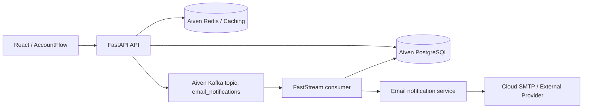
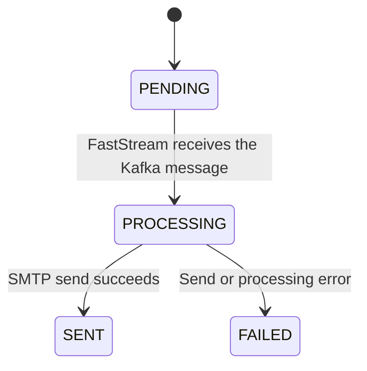

# Event-Driven Account Management Platform Backend

FastAPI-based account service with JWT authentication, PostgreSQL persistence, Redis-backed rate limiting, and asynchronous lifecycle email notifications powered by Aiven cloud services. Every account lifecycle email is persisted as a notification event so the client can show real processing history rather than inferred activity.

**Frontend:** [Event-Driven-Account-Management-Platform-frontend](https://github.com/DhrithiHH/Event-Driven-Account-Management-Platform-frontend.git)

**Backend repository:** [Event-Driven-Account-Management-Platform--backend](https://github.com/DhrithiHH/Event-Driven-Account-Management-Platform--backend.git)

## What it does

The service supports a focused account journey:

1. Register an account.
2. Obtain a JWT access token with username and password.
3. Read or update the authenticated account.
4. Delete the account after password confirmation.
5. View persisted lifecycle notification events for the authenticated account.

Registration, profile changes, and account deletion each create an event and enqueue an email asynchronously. The HTTP request does not wait for SMTP delivery.

## Architecture



- **Aiven PostgreSQL** stores users and `notification_events` over secure SSL/TLS.
- **Aiven Redis** stores sliding-window rate-limit state over encrypted TLS (`rediss://`).
- **Aiven Apache Kafka** decouples lifecycle email publishing from HTTP handling using mTLS client certificates (`ca.pem`, `service.cert`, `service.key`) or SASL_SSL.
- **FastStream** consumes the `email_notifications` topic and updates the matching notification event as processing progresses.
- **Cloud SMTP** handles delivery through configured external SMTP providers (SendGrid, Brevo, AWS SES, Mailgun, etc.).

The application is organized around domain, application, infrastructure, and presentation layers, with feature handlers and Dishka dependency injection.

## Technology stack

| Area | Implemented technology |
| --- | --- |
| API | FastAPI `>=0.119.1,<0.120.0`, Uvicorn `>=0.38.0,<0.39.0` |
| Validation/settings | Pydantic Settings `>=2.11.0,<3.0.0` |
| Database | PostgreSQL / Aiven PostgreSQL, SQLAlchemy `>=2.0.44,<3.0.0`, asyncpg `>=0.30.0,<0.31.0`, Alembic `>=1.17.0,<2.0.0` |
| Authentication | PyJWT `>=2.10.1,<3.0.0`, RS256 keys, pwdlib with Argon2 `>=0.3.0,<0.4.0` |
| Messaging/email | FastStream Kafka `>=0.6.7`, Aiven Apache Kafka (mTLS / SASL_SSL), aiosmtplib `>=5.1.0` |
| Rate limiting | Redis / Aiven Redis with TLS (`rediss://`) `>=7.3.0` |
| DI and tooling | Dishka `>=1.7.2,<2.0.0`, pip / uv, pytest, Ruff, MyPy |

## Features

- User registration, current-user lookup, profile update, and password-confirmed deletion.
- JWT-protected account and notification endpoints with automatic RSA-2048 keypair generation on startup.
- Argon2 password hashing through `pwdlib[argon2]`.
- Redis-backed per-IP and per-user rate limits on API routes with TLS support.
- Asynchronous `ACCOUNT_CREATED`, `ACCOUNT_UPDATED`, and `ACCOUNT_DELETED` emails via Aiven Kafka.
- Persistent, user-scoped notification history sorted newest first.
- Kafka messages carry the same UUID as the persisted notification event.
- SMTP health checking with `NOOP` and reconnection for stale transports.

## Notification lifecycle

### Event types

| Event type | Created when |
| --- | --- |
| `ACCOUNT_CREATED` | An account is successfully registered |
| `ACCOUNT_UPDATED` | The authenticated account is successfully updated |
| `ACCOUNT_DELETED` | Password-confirmed account deletion succeeds |

### Statuses



`notification_events` contains a UUID `id`, nullable `user_id`, `event_type`, `recipient`, `status`, `created_at`, and nullable `processed_at`.

- `created_at` records event creation.
- `processed_at` is set when processing completes as `SENT` or `FAILED`.
- The event ID is the Kafka `event_id`, so the consumer updates the same database record.
- The foreign key uses `ON DELETE SET NULL`. A deletion event is created before the user is removed, and notification rows survive account deletion with `user_id` set to `NULL`.
- `SENT` means the current SMTP operation succeeded. It does **not** prove inbox delivery, opening, or recipient engagement.

## API

The configured defaults expose Swagger UI at `http://localhost:8080/docs` and ReDoc at `http://localhost:8080/redoc`. The application URL and documentation paths are configurable through `APP_*` settings.

Protected endpoints require:

```http
Authorization: Bearer <access_token>
```

| Method | Path | Auth | Request body | Success response |
| --- | --- | --- | --- | --- |
| `POST` | `/api/v1/users` | No | JSON: `username`, `email`, `password` | `201` user object |
| `POST` | `/api/v1/token/access` | No | `application/x-www-form-urlencoded`: `username`, `password` | `201` token object |
| `GET` | `/api/v1/users` | Bearer | — | `200` current user |
| `PATCH` | `/api/v1/users` | Bearer | JSON with at least one of `username`, `email` | `200` updated user |
| `DELETE` | `/api/v1/users` | Bearer | JSON: `password` | `200` deleted user |
| `GET` | `/api/v1/notifications` | Bearer | — | `200` current user's events |

### Response shapes

User responses use:

```json
{
  "id": "uuid",
  "username": "account_name",
  "email": "user@example.com",
  "created_at": "2026-10-08T18:27:01Z",
  "updated_at": "2026-10-08T18:27:01Z"
}
```

The token endpoint returns:

```json
{
  "access_token": "<JWT>",
  "token_type": "Bearer"
}
```

`GET /api/v1/notifications` returns a plain JSON array, scoped from the JWT subject rather than a client-supplied user ID:

```json
[
  {
    "id": "uuid",
    "event_type": "ACCOUNT_UPDATED",
    "recipient": "user@example.com",
    "status": "SENT",
    "created_at": "2026-10-08T18:27:01Z",
    "processed_at": "2026-10-08T18:27:02Z"
  }
]
```

---

## Setup & Running with Aiven

This application runs natively on Python without requiring Docker containers, leveraging managed cloud instances from [Aiven](https://aiven.io).

### Prerequisites

- Python 3.12+ (or 3.13)
- An active [Aiven](https://aiven.io) account with:
  - **Aiven for PostgreSQL** service
  - **Aiven for Apache Kafka** service
  - **Aiven for Caching / Redis** service (or standard Redis with TLS)
- An SMTP account (SendGrid, Brevo, AWS SES, Mailgun, or local SMTP)

### 1. Clone & Switch to Charan Branch

```powershell
git clone https://github.com/DhrithiHH/Event-Driven-Account-Management-Platform--backend.git
cd Event-Driven-Account-Management-Platform--backend
git checkout charan
```

### 2. Create Virtual Environment & Install Dependencies

Using standard `pip`:

```powershell
python -m venv .venv
.\.venv\Scripts\Activate.ps1
pip install -r requirements.txt
```

Or using `uv`:

```powershell
uv venv
uv pip install -r requirements.txt
```

### 3. Configure Aiven Services in `.env`

Copy `.env_example` to `.env`:

```powershell
Copy-Item .env_example .env
```

#### A. Aiven PostgreSQL Configuration
In your Aiven Web Console, navigate to your **PostgreSQL** service and copy the **Service URI**:

```env
DATABASE_URL=postgresql+asyncpg://avnadmin:<PASSWORD>@<HOST>:<PORT>/defaultdb?ssl=require
```

#### B. Aiven Kafka Configuration
Download the three client certificates from your Aiven Kafka Overview page:
- `ca.pem` (CA certificate)
- `service.cert` (Access certificate)
- `service.key` (Access key)

Place them in `.certs/aiven/` inside this project (automatically detected) or specify their paths in `.env`:

```env
MESSAGE_BROKER_BOOTSTRAP_SERVERS=kafka-service-name.aivencloud.com:12346
MESSAGE_BROKER_SECURITY_PROTOCOL=SSL
MESSAGE_BROKER_SSL_CAFILE=.certs/aiven/ca.pem
MESSAGE_BROKER_SSL_CERTFILE=.certs/aiven/service.cert
MESSAGE_BROKER_SSL_KEYFILE=.certs/aiven/service.key
```

*(Alternatively, if your Aiven Kafka cluster uses SASL_SSL authentication, set `MESSAGE_BROKER_SECURITY_PROTOCOL=SASL_SSL` and configure your SASL username and password.)*

#### C. Aiven Redis Configuration
Copy the **Service URI** from your Aiven Redis overview:

```env
REDIS_URL=rediss://default:<PASSWORD>@<HOST>:<PORT>
```

#### D. SMTP Configuration
Configure your cloud or corporate SMTP credentials:

```env
SMTP_HOST=smtp.sendgrid.net
SMTP_PORT=587
SMTP_USE_TLS=False
SMTP_SENDER=noreply@yourdomain.com
SMTP_USERNAME=apikey
SMTP_PASSWORD=your-api-key
```

### 4. Run Database Migrations

Apply Alembic migrations directly to your Aiven PostgreSQL database:

```powershell
alembic upgrade head
```

### 5. Start the Application

Run the FastAPI API server and FastStream Kafka consumer:

```powershell
python -m fastapi_example
```

The service will start on `http://localhost:8080`.
Interactive API documentation is accessible at:
- **Swagger UI:** [http://localhost:8080/docs](http://localhost:8080/docs)
- **ReDoc:** [http://localhost:8080/redoc](http://localhost:8080/redoc)

---

## Testing

The repository uses `pytest` with async support:

```powershell
$env:PYTHONDONTWRITEBYTECODE='1'
$env:PYTHONPATH='src'
python -m pytest -o addopts='' -p no:cacheprovider -p no:cov
```

## Limitations and Future Work

- No transactional outbox, retry topic, dead-letter queue, or consumer idempotency mechanism is implemented.
- Kafka/SMTP processing is not exactly-once and does not guarantee delivery to an inbox.
- A send-time SMTP transport failure is not blindly retried because the SMTP server may have already accepted the message.
- `SENT` records SMTP-operation success, not recipient inbox placement, opening, or engagement.
- Potential future improvements include a transactional outbox, explicit retry/DLQ design, idempotency keys, tracing, metrics, and production notification-provider handling.

## Developer

**Dhrithi H H**

Email: [dhrithihh@gmail.com](mailto:dhrithihh@gmail.com)

GitHub: [github.com/DhrithiHH](https://github.com/DhrithiHH)
